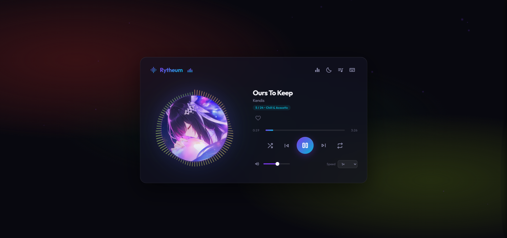

# 🎵 Rytheum — Modern Music Player

[](https://rytheum.github.io/musicplayer/)
[](https://developer.mozilla.org/en-US/docs/Web/HTML)
[](https://developer.mozilla.org/en-US/docs/Web/CSS)
[](https://developer.mozilla.org/en-US/docs/Web/JavaScript)

A sleek, modern, and feature-packed **Web Music Player** crafted with Vanilla HTML5, CSS3, and JavaScript. Featuring a dark-themed glassmorphic interface, real-time circular audio visualizer, 5-band graphic equalizer, custom playlist builder with drag-and-drop reordering, and smart playback tools.

🌐 **Live Demo:** [https://rytheum.github.io/musicplayer/](https://rytheum.github.io/musicplayer/)

---

## 📸 Preview



---

## ✨ Features

### 🎛️ Audio Visualizer & 5-Band Equalizer
- **Real-Time Spectrum Visualizer:** Animated canvas frequency spectrum pulsing around the circular album artwork.
- **5-Band Equalizer (EQ):** Fine-tune frequency bands (60 Hz, 250 Hz, 1 kHz, 4 kHz, 16 kHz) powered by the Web Audio API.
- **Built-in Presets:** One-click sound profiles including **Flat**, **Bass+**, **Pop**, **Rock**, and **Jazz**.

### 📂 Custom Playlists & Drag-and-Drop Reordering
- **Organized by Genre:** Tracks organized by genre categories (Chill & Acoustic, Pop & Ballad, Dance-Pop, EDM, R&B, J-Pop).
- **Create Unlimited Playlists:** Create, rename, and delete custom playlists effortlessly.
- **Custom Track Ordering (*Reorder*):**
  - **Drag & Drop:** Grab the handle (`⠿`) to slide and arrange tracks in any order you want.
  - **Arrow Controls (`▲` / `▼`):** Move tracks up or down with a single click.
- **Song Picker Modal:** Browse your collection and toggle songs into your playlist on the fly.
- **Persistent Storage:** All custom playlists, track orders, and preferences automatically persist in `localStorage`.

### 💖 Favorites System
- Mark your favorite tracks with an animated heart button.
- Toggle between all songs and your curated favorites with one click.

### ⏱️ Sleep Timer
- Fall asleep to your music without worrying about battery drain. Set timers for **5**, **10**, **15**, **30**, **45**, or **60 minutes** with live countdown status.

### 🎚️ Playback & Audio Controls
- **Playback Modes:** Shuffle toggle, Repeat All, Repeat One, and Repeat Off.
- **Speed Adjustment:** Select playback speeds from `0.5×`, `0.75×`, `1×`, `1.25×`, `1.5×`, to `2×`.
- **Dynamic Ambient Glow:** Adaptive background hue shifts in real-time based on the currently playing track.
- **Interactive Progress Bar:** Smooth scrubbing and visual progress feedback.
- **Volume Slider & Mute Toggle:** Responsive volume adjustment with custom styled range slider.

### ⌨️ Keyboard Shortcuts

Control playback seamlessly using hotkeys:

| Key | Action |
| :--- | :--- |
| <kbd>Space</kbd> | Play / Pause |
| <kbd>→</kbd> | Next Track |
| <kbd>←</kbd> | Previous Track |
| <kbd>↑</kbd> | Increase Volume |
| <kbd>↓</kbd> | Decrease Volume |
| <kbd>M</kbd> | Mute / Unmute |
| <kbd>S</kbd> | Toggle Shuffle |
| <kbd>R</kbd> | Cycle Repeat Mode |
| <kbd>L</kbd> | Like / Favorite Track |
| <kbd>P</kbd> | Toggle Playlist Drawer |
| <kbd>E</kbd> | Toggle Equalizer Panel |

### 📱 Fully Responsive Design
- Optimized for desktops, tablets, and mobile screens.
- On mobile devices, panels expand into full-width overlay drawers for a seamless native app-like experience.

---

## 🛠️ Tech Stack

- **HTML5:** Semantic markup, audio elements, and accessible modals.
- **CSS3:** Custom properties (CSS variables), glassmorphism effects, flexbox, grid, and fluid media queries.
- **JavaScript (ES6+):** Audio handling, Web Audio API (`AudioContext`, `BiquadFilterNode`, `AnalyserNode`), HTML5 Drag and Drop API, and LocalStorage API.
- **Google Fonts & Icons:** *Outfit* font family & *Material Symbols Rounded*.

---

## 🚀 Getting Started (Local Setup)

1. **Clone this repository:**
   ```bash
   git clone https://github.com/rytheum/musicplayer.git
   ```

2. **Navigate into the project directory:**
   ```bash
   cd musicplayer
   ```

3. **Launch the player:**
   - Double-click `index.html` to open directly in any modern browser, or
   - Use the VS Code **Live Server** extension for the best local development experience.

---

## 📂 Project Structure

```text
musicplayer/
├── images/           # Album art & icons (PNG)
├── js/
│   ├── app.js        # Core logic, Web Audio API, UI events & state
│   └── playlist.js   # Music database (track metadata & audio references)
├── music/            # Audio files (MP3)
├── preview/          # Screenshots for documentation
├── index.html        # Main application structure & modals
├── style.css         # Glassmorphic dark styling & responsive design
└── README.MD         # Project documentation
```

---

## 🎶 Adding Your Own Songs

1. Add your `.mp3` file to the `music/` directory.
2. Add your album art `.png` to the `images/` directory.
3. Open `js/playlist.js` and append your new song entry:
   ```javascript
   {
     name: "Your Song Title",
     artist: "Artist Name",
     img: "icon_name",
     audio: "audio_filename_without_extension",
     genre: "Genre Name",
     album: "Album Title"
   }
   ```

---

## 📄 License & Credits

Built with ❤️ by **[Jose / Rytheum](https://github.com/rytheum)**.  
Open-source and free for personal and educational use.
